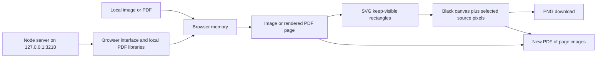

# Design and development history

This document describes how Image Obfuscator reached its current design. For operating instructions see [manual.md](manual.md); for installation and organisational deployment see [setup.md](setup.md).

## Starting problem

The repository's original description records a document-processing task performed manually by teams of people. The request for this application was to simplify that task into three actions:

1. Load an image.
2. Select areas that should remain visible.
3. Click Obfuscate so everything outside those areas becomes black.

The supplied illustration showed several text rows, with only selected rows retained. This established the selection rule: rectangles identify content to keep, rather than content to hide. The requested application also needed to start quickly and be simple to use. A local Node.js application with React was suggested as a preference.

## Decisions and their reasons

| Decision | Reason |
| --- | --- |
| Local Node.js server and browser interface | Simple startup; existing browser handles display and downloads. |
| Plain JavaScript instead of React | The small interface does not need a framework, build pipeline or development server. |
| Canvas for source preview and output | Supports pixel operations and PNG encoding directly in the browser. |
| SVG rectangles above the canvas | Clear selection feedback without changing the image or exported pixels. |
| Coordinates stored at source resolution | Selections remain aligned when the displayed image is scaled down. |
| Fill black first, then copy selected regions | Unselected content is absent from the resulting raster, rather than hidden behind removable shapes. |
| Original retained in browser memory | Users can revise selections without changing their source file. |
| Separate PDF state for each page | Users can finish one page independently and preserve the current state of every other page. |
| New PDF containing only processed page images | Source text, OCR, annotations and attachments are not copied into the exported document. |

The original image-only implementation had no third-party dependencies. PDF support subsequently introduced locally installed PDF.js for rendering and PDF-LIB for export. Runtime processing still does not require a remote service.

## How the application evolved

1. **Image workflow.** Added loading through a file chooser or drag and drop, multiple rectangular selections, undo, clear, obfuscation, editing and PNG download. Added a Windows launcher and focused geometry/rendering tests.
2. **Startup and verification.** The development environment initially prevented command execution. Once a working local runner was used, the application started successfully and was tested in Microsoft Edge. Browser checks verified actual pixels and downloads, rather than only checking button state.
3. **PDF support.** Added PDF loading, page navigation, per-page selections and PDF download. Pages are rasterised in the browser, with their displayed sizes retained in the export.
4. **Initial PDF behaviour.** The first PDF version applied Obfuscate to the entire document and blacked out pages without selections. This was an intermediate behaviour and is no longer the current rule.
5. **Page-specific revision.** The user requested that only the page being worked on be obfuscated. The application now tracks selections and obfuscation status separately. The button reads **Obfuscate this page**; untouched pages remain visually unchanged, even if selections have been drawn on them.
6. **Version control.** The project was initialised on Git branch `main`, then connected to [BFH-coder01/PdfImageObfuscator](https://github.com/BFH-coder01/PdfImageObfuscator). The pre-existing GitHub history and license were preserved through a merge before pushing the application.
7. **Operational documentation.** These guides document the implemented behaviour, GitHub installation and a local deployment model for concurrent organisational use.

## Architecture and data flow

The last connection represents PDF pages that have not been obfuscated: their original rendered appearance is included in the download. The Node process serves application files and bundled libraries. The app does not send selected documents to that process; PDF parsing, selection state, pixel processing and output creation occur in the browser. The server has no document database or upload endpoint.

### Source files

| File | Responsibility |
| --- | --- |
| `server.mjs` | Serve a fixed set of application assets and PDF resources on the local loopback address. |
| `index.html`, `style.css` | Interface, controls and responsive layout. |
| `app.js` | Loading, PDF rendering, page state, pointer selection, previews and exports. |
| `geometry.mjs` | Clamp rectangles to source bounds and compose blacked-out output. |
| `geometry.test.mjs` | Unit checks for selection boundaries and rendering order. |
| `browser-check.mjs` | Optional Edge/Playwright workflow and export checks. |
| `Start.bat` | Windows startup and first-use dependency installation. |
| `package.json`, `pnpm-lock.yaml` | Package requirements and the dependency versions used for reproducible installation. |

### PDF page state

Each page has its own rectangle list and obfuscation flag. Loading a PDF starts all flags as false. Clicking **Obfuscate this page** changes only the current flag. Navigation restores that page's preview and controls. **Edit selections** clears only the current flag and returns that page to its original appearance until it is obfuscated again.

Download is enabled after at least one PDF page is obfuscated. Export includes every page in order: obfuscated pages use their selected regions over black; other pages use their original rendered appearance. All output pages are flattened images, including untouched pages. Visual preservation does not mean preservation of searchable text, links, forms or digital signatures.

### Resolution and limits

Images retain their original dimensions. File loading is limited to 50 MB, and images to 40 million pixels. PDF pages normally render at scale 2, equivalent to 144 DPI for standard PDF units; exceptionally large pages use a lower scale to stay within 40 million pixels and a 16,000-pixel longest edge. This bounds individual page canvases, not total memory use for a document. Pages are rendered on demand, and PDF export processes them sequentially.

Rectangles are clamped to the source bounds and rounded inward to whole pixels. Overlapping selections are allowed. Blacked-out pixels are opaque. The canvas is not repainted for every pointer movement; selection feedback is drawn in SVG.

## Verification and practical limits

Verification has covered Windows, Node.js 24 and Microsoft Edge. Unit tests check reverse dragging, inward rounding, black-first rendering and full blackout with no selections. Browser checks cover image loading and export, every unselected image pixel, PDF page state, navigation, independent editing, and exported PDF page sizes. They also check that untouched PDF pages export with identical raster pixels and that selections alone do not obfuscate a page. Exported PDFs were reopened and their rendered pages visually inspected.

This is a local document tool, not a multi-user records system. There is no login, shared queue, collaboration, saved selection project, audit trail or central retention policy. Loading another file, refreshing or closing the tab loses in-memory work. Browser and device management remain the organisation's responsibility. Local processing does not prevent browser extensions, endpoint software or synced download folders from accessing files.

## Future work, separate from current delivery

Possible extensions include movable/resizable selections, zoom controls, saved projects, batch processing and an explicit document-level review summary. A shared hosted service would need its own deployment and access-control design; changing the listening address alone would not deliver those organisational controls. These features are not implemented.
